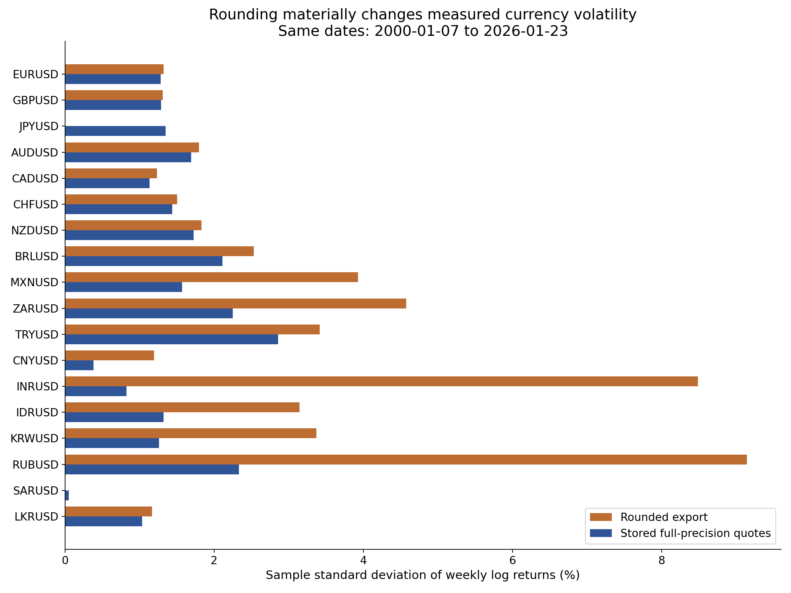

# Exchange-rate precision audit

Common price dates: **2000-01-07 through 2026-01-23** (1,360 weeks). Both versions use 100 × Δln(S), sample SD, and the same valid paired return dates. The January 30 observation is excluded here to isolate precision effects.

Overlap checks: 0 differences in missingness; 67 quote differences exceed the single-step half-cent rounding bound. However, rounding precise quotes first to four decimals and then to two (decimal half-up) reproduces the legacy values with 0 mismatches. This is evidence of double rounding; the original export procedure is unknown.

| Currency | Paired returns | Rounded mean % | Precise mean % | Rounded SD % | Precise SD % | SD ratio | Rounded zero returns % | Precise zero returns % |
|---|---:|---:|---:|---:|---:|---:|---:|---:|
| EURUSD | 1359 | 0.0100 | 0.0102 | 1.3224 | 1.2807 | 1.0326 | 28.2561 | 0.3679 |
| GBPUSD | 1359 | -0.0138 | -0.0135 | 1.3110 | 1.2850 | 1.0203 | 21.2656 | 0.2943 |
| JPYUSD | 1359 | 0.0000 | -0.0287 | 0.0000 | 1.3481 | 0.0000 | 100.0000 | 0.7358 |
| AUDUSD | 1359 | 0.0044 | 0.0038 | 1.7939 | 1.6909 | 1.0609 | 35.6144 | 0.3679 |
| CADUSD | 1359 | 0.0041 | 0.0045 | 1.2339 | 1.1355 | 1.0867 | 45.4010 | 0.3679 |
| CHFUSD | 1359 | 0.0510 | 0.0512 | 1.5008 | 1.4377 | 1.0439 | 32.5975 | 0.2943 |
| NZDUSD | 1359 | 0.0093 | 0.0102 | 1.8299 | 1.7268 | 1.0597 | 36.9389 | 0.2943 |
| BRLUSD | 1359 | -0.0782 | -0.0782 | 2.5285 | 2.1115 | 1.1975 | 53.9367 | 1.0302 |
| MXNUSD | 1359 | -0.0446 | -0.0445 | 3.9307 | 1.5695 | 2.5044 | 92.8624 | 0.5151 |
| ZARUSD | 1359 | -0.0766 | -0.0721 | 4.5757 | 2.2465 | 2.0369 | 81.4570 | 0.0000 |
| TRYUSD | 1359 | -0.3331 | -0.3228 | 3.4157 | 2.8544 | 1.1966 | 53.7896 | 0.2943 |
| CNYUSD | 1349 | 0.0114 | 0.0137 | 1.1965 | 0.3788 | 3.1588 | 96.8866 | 14.6775 |
| INRUSD | 1359 | -0.0510 | -0.0550 | 8.4889 | 0.8225 | 10.3210 | 98.3076 | 4.7093 |
| IDRUSD | 1357 | -0.0624 | -0.0610 | 3.1452 | 1.3233 | 2.3769 | 92.6308 | 1.1791 |
| KRWUSD | 1359 | -0.0185 | -0.0185 | 3.3716 | 1.2614 | 2.6729 | 92.0530 | 1.1773 |
| RUBUSD | 1359 | -0.1020 | -0.0747 | 9.1464 | 2.3332 | 3.9201 | 96.6887 | 4.1943 |
| SARUSD | 1359 | 0.0000 | 0.0000 | 0.0000 | 0.0512 | 0.0000 | 100.0000 | 61.8837 |
| LKRUSD | 1359 | -0.1070 | -0.1065 | 1.1661 | 1.0328 | 1.1290 | 78.8815 | 11.3319 |

## Correlations

Rounding makes 33 of 153 distinct currency-pair correlations undefined that are defined in the precise data. JPYUSD and SARUSD become constant series; undefined correlations are blank, never zero.

| Pair | Rounded correlation | Precise correlation | Absolute change |
|---|---:|---:|---:|
| ZARUSD / KRWUSD | 0.0641 | 0.4680 | 0.4039 |
| INRUSD / KRWUSD | 0.0729 | 0.4719 | 0.3989 |
| AUDUSD / KRWUSD | 0.2085 | 0.5853 | 0.3768 |
| MXNUSD / ZARUSD | 0.1130 | 0.4757 | 0.3627 |
| MXNUSD / INRUSD | 0.0278 | 0.3898 | 0.3620 |
| MXNUSD / KRWUSD | 0.0317 | 0.3922 | 0.3605 |
| NZDUSD / INRUSD | 0.0345 | 0.3886 | 0.3540 |
| AUDUSD / INRUSD | 0.0522 | 0.4043 | 0.3522 |
| NZDUSD / KRWUSD | 0.1950 | 0.5353 | 0.3403 |
| IDRUSD / KRWUSD | 0.0503 | 0.3890 | 0.3387 |

## Interpretation and limits

Rounding suppresses many ordinary weekly moves and concentrates changes into artificial jumps. It can either inflate volatility or erase it. Mean log returns also change because endpoints are rounded; with missing quotes, the mean averages only valid adjacent weekly intervals.

The main corrected outputs include January 30, 2026 and therefore have one additional week. They remain historical: no Fall 2026 observations were obtained. Six source quotes are missing (five CNYUSD and one IDRUSD); each removes two adjacent weekly returns. Pairwise correlation sample sizes are exported separately.

The workbook preserves stored quote values; the precise CSV agrees within 1e-15 relative tolerance (one binary floating-point last-bit difference). Extra workbook digits often reflect Excel binary serialization, not extra economic precision. No missing quote is filled and no currency scale is changed. Constant quote scaling cancels in log returns; changing scaling would not.

Some source series appear scaled (notably IDRUSD, KRWUSD and LKRUSD). The original export does not include ticker scale metadata. Charts label the source scale, and a future Bloomberg refresh must verify the same tickers, field, quote direction, units and weekly convention.

Reproduce with `python analysis/compare_precision.py`. Numeric CSVs and the volatility chart are in this directory.

